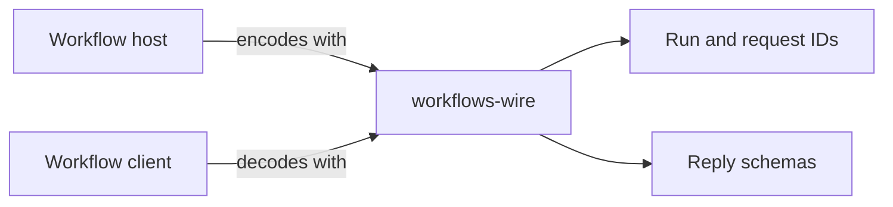

# Workflow wire (`@fungi.computer/workflows-wire`)

Workflows-wire is the shared definition of workflow runs: the IDs and replies
that a workflow host and its clients send each other.



## Quick start

Install it:

```sh
npm install @fungi.computer/workflows-wire
```

```ts
import { workflowRunRequestIds } from "@fungi.computer/workflows-wire";

const requestId = workflowRunRequestIds.request.generate();
console.log(workflowRunRequestIds.request.parse(requestId).ok);
```

## Common tasks

### Mint and check a request ID

`workflowRunRequestIds.request` generates and parses IDs. See the Quick start.

### See what it contains

See [What it contains](#what-it-contains).

### Run the package checks

See Examples and checks.

## Reference

### Overview

The shared data contract for workflow runs: run and request IDs and the reply
schemas a workflow host and its clients exchange.

## Install

```sh
npm install @fungi.computer/workflows-wire
```

## What it contains

Workflow run and request IDs, plus the generic graph reply schemas (catalog,
start, status, cancel, review, schedules and event triggers), live at the root.
Hub and the Trellis App consume this package without an App-to-App dependency.

## Core concepts

Identifiers and decoded wire values are data contracts. This package does not
own workflow execution, App admission or run persistence.

## Examples and checks

The packed runtime fixture at `test/stranger/runtime.mjs` exercises the public
API in a fresh consumer. Run `pnpm run stranger` after building the package.

## Contribute and license

See [LICENSE](LICENSE) for the MIT terms.

## Packed consumer readiness

Run `pnpm run build`, `pnpm run pack` and `pnpm run stranger` in this package.
The maintained stranger proof installs only package tarballs into a fresh npm
consumer, checks the exact shipped files, runs the public runtime fixture and
compiles every JavaScript entrypoint with strict NodeNext and no library-check
skip. This qualification does not publish npm releases or push a repository
split.
